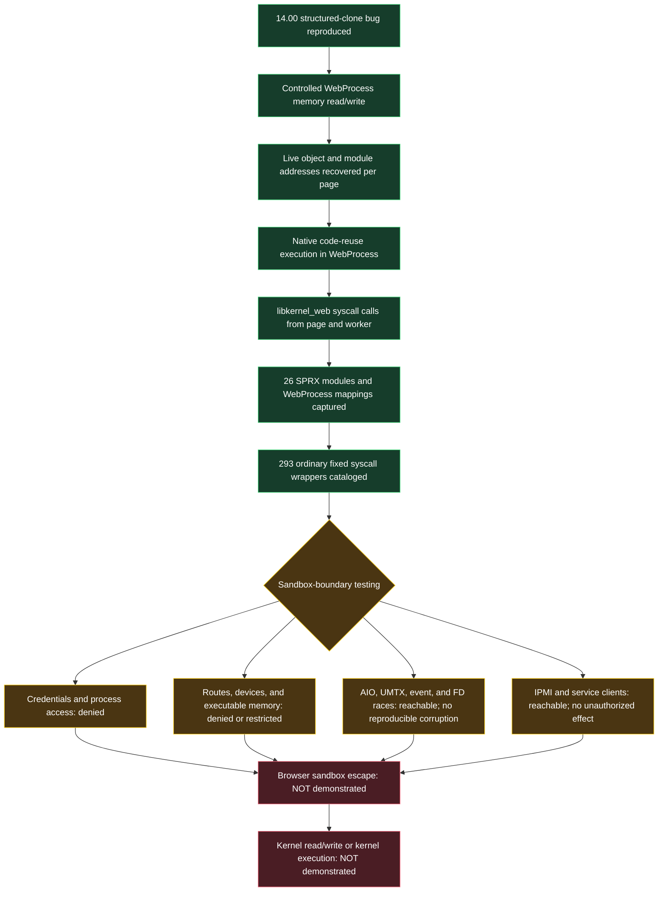

# PS4 14.00 research: achievements and tested-return map

Updated 2026-10-24. This is a shareable summary of results measured on the
retail PS4 reporting firmware 14.00. It excludes results that only came from
older firmware. Numeric syscall wrappers are direct 14.00 observations;
names inherited from FreeBSD or older PS4 tables are labels unless the
captured 14.00 callers and live behavior also support the contract.

## Copyable progress graph



Plain-text version:

```text
14.00 WebKit bug
  -> controlled browser-process read/write
  -> per-page address recovery
  -> native code-reuse execution
  -> direct libkernel_web calls on page + worker threads
  -> full WebProcess/SPRX capture and reverse analysis
  -> 293-wrapper syscall map + selected IPC/service contracts
  -> sandbox boundary mapped, but not crossed
  -> no kernel read/write and no kernel execution
```

## Milestone ledger

| Milestone | Status | Direct result |
|---|---|---|
| WebKit trigger on 14.00 | **Achieved** | Structured-clone/BigInt graph behavior produced the wrong backing/view relationship. |
| Browser-process memory read/write | **Achieved** | Fresh-page repeated reads and reversible writes reached live cloned buffers, object fields, pointers, and native structures. |
| WebKit-process code execution | **Achieved** | A restored code-reuse chain called mapped native functions and fixed-number syscall wrappers. This is native execution by code reuse; anonymous generated code remained non-executable. |
| Worker-side native execution | **Achieved** | An independent worker chain returned the browser PID, slept natively while page JavaScript advanced, and performed event waits and follow-up calls. |
| Full userland capture | **Achieved** | 167,526,400 of 167,542,784 read-permitted bytes captured (99.990221%); all 28 executable mappings complete. |
| Loaded-module map | **Achieved** | 27 initial handles: `NKWebProcess.self` plus 26 SPRX modules. All 26 module images were structurally mapped. |
| `libkernel_web` map | **Achieved** | 293 unique ordinary fixed-number wrappers, 302 canonical fixed-number sites including special sites, and no extra canonical gateway in the other 25 modules. |
| Main executable reverse pass | **Achieved** | 66 live import bindings resolved; startup `FMEMSizeLimit` path identified. |
| Live memory limit | **Measured** | Number 194 with resource 10 returned soft limit 1,536 MiB and hard limit `0x7fffffffffffffff`. |
| Syscall/IPC boundary map | **Substantial** | Core calls, custom wrappers, AIO, routing, IPMI, devices, and service clients tested with readback and cleanup. |
| Sandbox escape | **Not achieved** | No credential change, protected process action, unauthorized route, protected resource, or equivalent boundary effect. |
| Kernel read/write | **Not achieved** | No controlled kernel address or kernel-memory primitive. The old number-638 “KBASE” interpretation was withdrawn. |
| Kernel execution | **Not achieved** | No kernel control-flow primitive or kernel payload execution. |

## Return-value legend

- `0` means the tested call shape was accepted. It does **not** by itself
  mean a privilege change or exploitable condition.
- `-1/EPERM`, `-1/EINVAL`, and similar entries are the native return and
  immediate same-thread errno.
- `0x80......` values are Sony service or per-object status values rather
  than Unix errno returns.
- “Warning,” “freeze,” or “page loss” means no after-call result was
  captured. Those outcomes are availability observations, not proven
  kernel panics.

## Core and boundary syscall results

| No. | Contract used in the test | Inputs or operation | Observed 14.00 result |
|---:|---|---|---|
| 3 | `read` | One byte from `/dev/dmem0` | `-1/ENODEV`; output and guard unchanged. |
| 5 | `open` | Browser-visible paths | `/dev/random`, `/dev/dce`, and `/dev/dmem0` opened; `/dev/null` returned `ENOENT`. |
| 6 | `close` | Owned descriptors | `0`. |
| 20 | `getpid` | No arguments | Returned the current WebProcess PID; repeatedly used as the native-chain control. |
| 23 | `setuid` | `setuid(0)` | `-1/EPERM`; a later UID read remained `1`. |
| 24 | `getuid` | No arguments | `1`. |
| 29 | `recvfrom` | Nonblocking read from two accepted local sockets | `0` bytes immediately; both peers closed the no-payload connection. |
| 37 | `kill` | Signal 0 | Self: `0`; parent PID: `-1/EPERM`. |
| 39 | `getppid` | No arguments | Returned parent PID `38` in the recorded sessions. |
| 41 | `dup` | Owned socket/event descriptors | Successful in the descriptor-lifetime controls. |
| 54 | `ioctl` | Four `/dev/dipsw` output getters | `0`; outputs were ordinary zero values. A source-shaped `/dev/dce` request returned `EPERM`. |
| 73 | `munmap` | Owned mappings | `0`. |
| 74 | `mprotect` | RW to RX or RWX | `-1/EACCES`; VM readback remained RW. |
| 92 | Descriptor-control candidate | Commands 1 and 10 on event queue; command 1 on `/dev/random` | `-1/EINVAL` in every tested shape. |
| 97 | `socket` | Route socket and ordinary socket controls | Route socket opened as fd 9; invalid family 255 returned errno 43. |
| 98 | `connect` | `/system_tmp/SceKernelDescPassing` | `-1/ENOENT`. Two other service sockets accepted the browser, but closed without a payload. |
| 118 | `getsockopt` | Local peer-credential-shaped query | `0` on two accepted service sockets; returned a version-zero/UID-zero-shaped record under the historical layout. Identity remains unverified. |
| 135 | `socketpair` | Owned local pair | `0`; used for AIO, event, and descriptor-reuse controls. |
| 194 | `getrlimit`-shaped | Resource 10 | `0`; soft `0x60000000` (1,536 MiB), hard `0x7fffffffffffffff`. |
| 195 | `setrlimit`-shaped | Startup path only | Captured code calls it after 194; no independent live setter result claimed. |
| 196 | `getdirentries` | `/` and `/dev`; later `/system_tmp` | Successful bounded listings with descriptors closed. |
| 202 | `sysctl` | `kern.osrelease`, jail MIB, process records | OS release read succeeded; `security.jail.jailed` read returned `ENOENT`; self process record succeeded, parent `EPERM`, absent PID `ESRCH`. |
| 209 | `poll` | Route socket and owned descriptors | Returned readable when replies were available. |
| 240 | Sleep call | Worker 300 ms sleep | `0`; page timer fired while worker was blocked. |
| 362 | Event-queue create | No arguments | Returned fd `9`. |
| 363 | Event registration/wait | User event and socket readiness | Add/trigger/delete controls succeeded; waits returned one matching event. Race runs returned either registration `0` or `EBADF`, with no stale old-source event. |
| 379 | Historically `mtypeprotect` | Guessed four-argument RW/RX/RWX shapes | `-1/errno 45` for RX, RWX, and matched RW no-op; ABI not validated. |
| 432 | `thr_self`-shaped | Owned output pointer | `0`; wrote current TID `101047` in the recorded session. |
| 454 | `_umtx_op` | Ops 4/5/6 | Try-lock `0`, lock `0`, unlock `0`; owner word was written then cleared. Operation-25 shared-memory shapes returned `EINVAL`. |
| 456 | `sigqueue` | Signal 0 | Self: `0`; parent PID: `-1/EPERM`. |
| 477 | `mmap` | Anonymous RW/RX/RWX | Returned mappings, but VM readback was RW, R, and RW; requested execute permission was stripped. Device maps: `/dev/dmem0` `EPERM`, `/dev/dce` `EACCES`. |
| 481 | `thr_kill2`-shaped | Signal 0 | Own TID: `0`; real parent TID: `EPERM`; nonexistent TID: `ESRCH`. |
| 532 | RegMgr transport | Source-derived reads/writes | Protected key read: `EPERM`; fallback transport `0` with service status `0x800d0203`; idempotent writes returned service status `0x800d0214` and readback did not change. |

## Custom-wrapper census, 545–668

The project byte-checked 116 wrappers in this range and classified about 60.
The compact rows below preserve the argument dependence instead of treating a
single success code as the syscall's full contract.

| Numbers | Tested result |
|---|---|
| 545, 546 | `ESRCH` for nonexistent event-filter IDs. |
| 547 | `EINVAL` for null, mapped, and aligned query-memory shapes; no output. |
| 548 | Zero-entry call: `0`; one-entry batch-map shapes: `EINVAL`, no output. |
| 550, 552, 555, 556 | `ESRCH` for nonexistent semaphore IDs/objects. |
| 551 | Unknown name: `ESRCH`; malformed handle/buffer: `EFAULT`; long non-NUL name: `ENAMETOOLONG`. It did not open a 557-created object. |
| 557 | Created owned objects and returned live handles. Non-NUL names of at least `0x20` bytes returned `ENAMETOOLONG`. |
| 558 | Live matching handle/kind deletion: `0`; wrong kind, stale generation, double delete, foreign handle, or absent ID: `ESRCH`. |
| 559, 561, 562, 586, 600, 603, 604, 611, 613, 614 | `EPERM` in the sampled privilege-gated shapes. Historical names include VM-container, process suspend/resume, sandbox-path, metadata, and paging/resident queries. |
| 560 | Returned `0` in tested process-local debug-init shapes; feeding a 557 handle did not unlock 601 request 1 or change request-0 status. |
| 563–566 | `0` with sampled zero-argument shapes. |
| 567 | `ESRCH` in the sampled no-counter/ID shape. |
| 585 | Returned `1`; historical name `is_in_sandbox`. |
| 587 | Existing PID: `0` plus a 136-byte auth record; absent PID: `ESRCH`. Records for other PIDs did not grant process-record access. |
| 588 | Layout sweep returned `EINVAL`/`EFAULT`; no data copied. |
| 591 | Tested symbol names returned `-1/ESRCH`; no export address resolved. |
| 592 | Valid module-list shape: `0`, initially 27 handles. A too-small size could return `EFAULT` after 108 bytes were copied. |
| 593 | Valid module-info shape: `0` and module name/info. |
| 595 | Live module handle 16: `0`, followed by its disappearance from the same-PID 592 list. Invalid handles: `ESRCH`. This was a process-local unload. |
| 596, 599, 606, 617, 620, 639, 640, 643 | `0` in the sampled shapes. Number 606's historical interpretation is development mode, and the observed return was 0. |
| 598 | Returned the WebProcess ProcParam pointer. Root contained `ORBI` and SDK `0x14008001`; this is userland process data, not a kernel base. |
| 601 | Live request dispatcher; full selector table is below. |
| 602, 618, 623, 628, 636, 642 | `EPERM` in the sampled pointer/ID shapes. |
| 605 | `EINVAL` in sampled compatibility-stub shapes. |
| 607 | Browser SELF path: `EACCES`; nonexistent path: `ENOENT`. |
| 608 | 557-created handles: `ESRCH`; no dynlib type confusion observed. |
| 610 | Sixteen-case matrix: small/sample IDs `ENOSYS`; only `0xffffffff` returned `2`; output buffer unchanged. |
| 615 | Valid self PID plus two outputs: `0`, with resident counters; parent and absent PID: `EPERM`. A touched 2 MiB allocation increased both counters by 128 pages. |
| 616 | `ESRCH` for invalid/nonmatching thread IDs. |
| 619 | Later 16-case matrix: `ENOSYS` for every tested input; no output change. |
| 624 | Returned nondecreasing positive values that sometimes repeated (`40036`, `40037`, ...). Behavior fits a VM-map timestamp; values are not established handles. |
| 627, 635, 641 | `ENOSYS` for sampled values. |
| 630 | Name-keyed malformed shape returned `EFAULT`; no working object obtained. |
| 632, 633, 634 | `ESRCH` for sampled/changing 624 values. |
| 637 | `637(0, 0xffffffff)` returned `0`; sandbox/development tuple stayed `1/0`, and no effective limit change was measured. |
| 638 | Returned `input - 21,600 seconds`; this is timezone conversion behavior, not a kernel-base leak. |
| 646 | Kernel-statistics-shaped owned output call: `-1/EPERM`; zero output bytes changed. |
| 649 | Valid Sysmodule handle/member query: `0`; wrote a pointer to its local RW parameter block, size `0x20`, SDK `0x14008001`. |
| 659 | Malformed size/pointer shapes returned `ENOMEM`/`EFAULT`; no list copied. |
| 661 | Four malformed calls ended the WebProcess before any return was captured. Historical name `aio_submit`; no kernel effect established. |
| 668 | Null-argument call reached the before marker, then a memory warning and refresh; no return captured. |

## Number 601 request-selector map

| Selector | Null-arg2 result | Follow-up |
|---:|---|---|
| 0 | `EFAULT` | Owned 256-byte arg2 returned `0` and wrote eight-byte value `0x100`. |
| 1 | `EFAULT` | Readable zeroed or field-varied structure returned `EINVAL`; matching live 557 object did not change it. |
| 2 | `ENOSYS` | — |
| 3 | No return | Null and owned-buffer tests both produced a memory warning/page loss. |
| 4 | `0` | Repeated with null, invalid, and owned pointers; no buffer or measured authority change. |
| 5, 6, 7 | `ENOSYS`, `ENOSYS`, `0` | Selector 7 with owned buffer wrote nothing. |
| 8 | No return | Browser froze. |
| 9, 10, 11 | `0`, `EPERM`, `0` | Successful selectors wrote nothing to owned buffer. |
| 12 | No return | Unresponsive-page prompt; stopping it led to memory warning. |
| 13, 14, 15 | `0`, `EFAULT`, `EPERM` | A two-pointer selector-14 shape moved to `0` without measured authority change. |
| 17, 18, 19 | `EFAULT`, `EFAULT`, `0` | Selector 19 wrote nothing to owned buffer. |
| 20 | `0` | Owned buffer unchanged. |
| 21, 22, 23 | `EPERM`, `ENOSYS`, `ENOSYS` | — |
| 24, 25, 26 | `EPERM`, `0`, `EFAULT` | Selector 25 wrote nothing to owned buffer. |
| 27 | No return | Memory warning and refresh. |
| 28, 29, 30, 31 | `EFAULT`, `0`, `EINVAL`, `EFAULT` | Two-pointer selector 31 moved to `EPERM`; selector 29 wrote nothing. |
| 32 | `0` | Owned buffer unchanged. |
| 33, 40, 64, 96, 128, 255 | `ENOSYS` | Sampled values only; this does not prove a complete upper limit. |

No 601 selector changed `is_in_sandbox`, development mode, or
`sandbox_path` in the measured comparisons.

## AIO syscall-family results

| No. | Historical/current contract | Observed 14.00 result |
|---:|---|---|
| 662 | Multi-delete | Completed ID: syscall `0`, per-ID `0`; duplicate: first `0`, second `0x80020003` (`ESRCH`); processing ID: `0x80020010` (`EBUSY`) until completion. |
| 663 | Multi-wait | Finite 10,000-usec wait: `-1/ETIMEDOUT`; null timeout on an unreadable socket blocked and caused an unresponsive console session. |
| 666 | Cancel-shaped call | Returned `0`, but a pending read remained in state 2 and completed normally after peer write. No effective cancellation proved. |
| 669 | Submit command | Valid one- and two-request 40-byte reads submitted and completed; zero-request commands 1, 2, `0x1001`, and `0x1002` returned `EINVAL`. |
| 670 | Init | Zero-argument sample returned `0`; no stronger contract established. |
| 671, 672, 677 | Page/dynlib/physical-page tail candidates | `EPERM` in two basic shapes. |
| 674 | `virtual_query_all`-shaped | Six owned-buffer shapes returned `EINVAL`; no output. |
| 675 | `reserve_2mb_page`-shaped | Candidate shape returned `EPERM`; output untouched. |

Concurrent 662 deletion produced one single-request dual-success output in
one of seven first runs. Six immediate peers, eleven two-request runs,
twenty-two three-request runs, and twenty-one later same-WebProcess repeats
all produced one winner. No changed guard, surviving corrupt request, kernel
read/write, or privilege effect followed. The older multi-request double-free
was not reproduced.

## Routing, IPC, and service results

| Surface | Result |
|---|---|
| Route socket `RTM_GET` | Working two-way kernel message channel. IPv4/IPv6 replies parsed; author lengths through 255 returned cleanly. The published upstream oversized-author shape did not produce a fault or memory primitive. |
| Route socket `RTM_ADD` | Valid TEST-NET route add returned `-1/EPERM`; an independent socket observed no route-table change. |
| IPMI number 622 | Nonexistent server: `ESRCH`. `SceSysCoreApp`: transport `0`, connected peer PID 38, then clean disconnect/destroy. Generic VideoCore connect: transport `0` but result `0x80dc0001` and no session. Existing module-owned VideoCore session reported peer PID 46. |
| VideoCore request `0x12340017` | Returned `0` and a changing four-byte value; it was not a stable capability bit. |
| VideoCore media lifecycle | Exact `0x9f8` create/status/delete returned `0/0/0`, handle 1; collector received no URL request and no protected effect. |
| SystemService/LNC | App-status read succeeded. Launch, list, GPU-status, and termination-shaped requests returned `0x8094000F` (`NOT_ALLOWED` under the public table). |
| SysCore | Connected getters returned `0x80AA000B`; App2 connect returned `ESRCH`; no process launch. |
| NetCtl | Method `0x20004` returned `0` and value 3; six other output methods returned `0x804121a1` and zero output. |
| Mbus / AvSetting | Mbus method returned `0x809b00ff`; AvSetting initializer returned `0x809a00ff`; no usable client effect. |
| VideoOut | `/dev/dce` output query returned `EPERM`; four `/dev/dipsw` getters returned `0` and zero values. |
| Local service sockets | `GnmCompositorRestricted` and `gpvdec_proxy` accepted a connection, exposed UID-zero-shaped peer data under a historical layout, then closed immediately with no payload. Other named sockets returned `EPERM`. |

## Current conclusion

The project has crossed the **WebKit code-execution milestone**: it has
controlled WebProcess memory read/write and repeatable native code-reuse calls,
including syscalls from the page and a worker. It has also captured and mapped
nearly the full browser process and tested multiple kernel and broker surfaces.

The next unachieved milestone is still **sandbox escape**. Every result so far
falls into one of four classes: ordinary permitted behavior, a clean permission
denial, an argument/ABI failure, or an availability event without a controlled
security effect. Consequently, kernel read/write and kernel execution remain
unachieved.

